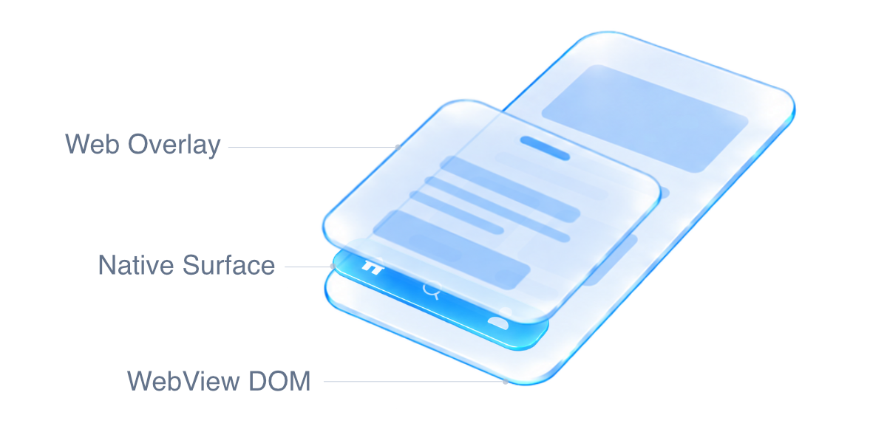

# WebView Native UI Engine

**Bring Web UI above the native layer.**

_Visually, through seamless native-to-Web projection._

_Conceptual view. Native appearance is projected into the Web layer during overlay presentation._

Build WebView apps where native controls and Web content share the same scrolling screens, transitions and overlays.

## Beyond the WebView boundary

WebView apps combine the Web's flexible layouts with access to native platform capabilities. But native UI and the Web page live in separate rendering layers. A native control placed above the WebView does not automatically participate in DOM scrolling, clipping or stacking order. A Web modal cannot simply cover it with a higher `z-index`.

Crossing that boundary takes more than a bridge call. It requires coordinating placement, appearance, input, rendering and restoration across two rendering systems on each platform. Rebuilding that coordination for every component makes otherwise useful designs expensive to deliver and maintain.

WebView Native UI Engine makes that work reusable. It lets applications combine native UI with Web-driven screens and interactions, while sharing the machinery that moves presentation between the two layers. The goal is to expand what a WebView app can be built to do—and make that practical to ship.

## What this makes possible

- **Native UI within Web-designed screens.** Combine native toolbars, tab bars, player controls and eligible SDK views with the application's DOM layout and navigation.
- **Web overlays that coexist with native content.** Present modals and other overlays over native surfaces, then return to the interactive native UI when they close.
- **Scrolling and transitions that retain native appearance.** Carry the native surface's captured appearance through Web-layer movement, without recreating its styling in CSS.
- **Shared infrastructure across components and platforms.** Reuse the same projection and restoration lifecycle on iOS and Android instead of implementing it independently in every integration.

## The approach

Use the live native view where it belongs, and a prepared visual projection in the DOM when the Web layer needs to own presentation. Restore the interactive native view when it can take over again. An existing DOM container gives the Web projection its place in the application's layout and layer structure.

The Engine coordinates this handoff; the integrating renderer still creates and positions its views. A projected image preserves appearance, not live interaction or video. Capture availability and layout support determine when a projection can be used, with an explicit fallback when it cannot. See [projection behavior](docs/projection.md) for the detailed contract and limits.

## Integration

Applications gain these capabilities through plugins that integrate the Engine. Capacitor and Cordova plugin authors add it as a library dependency while retaining their existing native controls and public APIs. The same Engine supports iOS and Android. Ionic and Angular are not required; Ionic overlay coordination is optional.

- [Capacitor plugin guide](docs/capacitor-plugin.md) — install dependencies and add registration, events and teardown to your existing plugin.
- [Cordova plugin guide](docs/cordova-plugin.md) — integrate the same Engine with Cordova's lifecycle and resource handler, without a Capacitor dependency.

Native registration starts the Web runtime; applications do not need a separate Engine initializer for the base integration. Keep your plugin's normal API and notifications.

The current API is pre-1.0. Use matching, pinned Engine versions across npm and native dependencies. Android placement requires API 23+, with composited snapshots available from API 26+.

## Further reading

- [Projection behavior and advanced integration](docs/projection.md) — DOM requirements, lifecycle, fallback policies, optional Ionic support and lower-level APIs.
- [Development and releases](docs/maintenance.md) — repository structure, validation and publishing.

## License

[Zlib](LICENSE). Commercial use, modification and redistribution are permitted with the license's notice and attribution requirements. [NOTICE](NOTICE) preserves upstream MIT notices; the Engine's license does not change the licenses of applications or plugins that depend on it.
