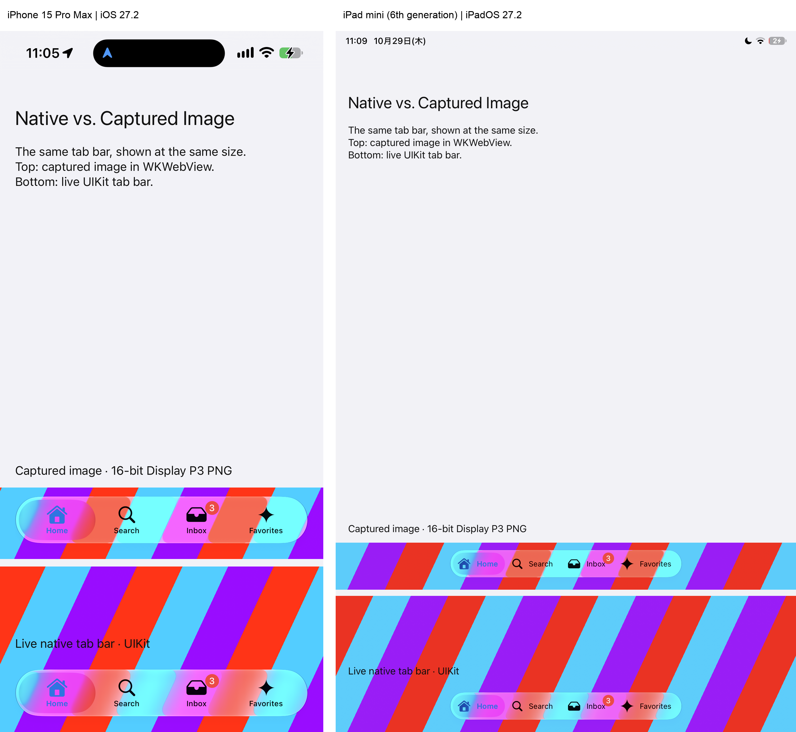

# Capture and platform limits

Choose capture and fallback settings for the actual native surface. Start with
the [projection contract](projection.md) and [configuration guide](../configuration/README.md);
this reference describes platform behavior and limits, not additional setup steps.

An opaque card in a feed and a translucent player control need different capture
choices. Drawing the card alone can avoid capturing neighboring content; drawing
the translucent control alone loses the background it blends with. Use the cases
below to choose capture behavior, and retain a Web fallback for content that
cannot be captured. These choices preserve available pixels, not live video or
all effects of the platform compositor.

## Android capture modes

For opaque, software-renderable Android SDK views, use
`captureMode = NativeUIProjection.CaptureMode.VIEW` together with an explicit
`failedFallback` policy (`WEB` unless the consumer maintains native placement). This draws only the View's
pixels with no surrounding padding, so clipping a partially visible ad cannot bake
in a toolbar or adjacent content. Video, SurfaceView, translucent views, and content
requiring Window composition must keep the default `COMPOSITED` mode. The consumer
must provide a matching, clipped DOM host for the full opaque View; arbitrary native
outline masks, transforms, and custom clipping are not reproduced.

VIEW pixels are cached by native View identity, dimensions, and content revision.
Ordinary scrolling retains the decoded Web image and updates placement without
capture, PNG encoding, or image decode. The image covers the host border box at
local origin (0, 0), independently of native placement acknowledgment latency.
Opaque images remain painted beneath the live native View between scrolls.
Before hiding that View, the engine waits for WebView visual readiness and a draw;
VIEW creates no native entry or return image copies. Return acknowledgment waits
across the native draw and the following animation frame. A generation check prevents
a delayed cover callback from hiding content after restoration or suspension.

The native Bitmap is recycled after PNG encoding in VIEW mode; the PNG and decoded
Web image remain cached. Plugin update notifications advance the content revision:
notify an update whenever content changes without replacing the View. Replacing the
registration, WebView navigation, reset, or close retires the cache. Encoding stays
off the UI thread; View drawing and cache ownership stay on it, with the existing
8-million-pixel cap.

COMPOSITED retains native handoff copies for translucent content. Entry copies wait
for WebView visual readiness and a draw before retirement. If the 500 ms entry
deadline expires, the native View is restored before the copy is removed, and a late
paint acknowledgment is rejected.

## Android library

Android uses a Gradle Android library, distributed as an AAR through Maven rather than Capacitor plugin registration. The publication coordinates are `io.github.webview-native-ui:engine:<version>`. Build and verify the local Maven publication with:

```sh
android/gradlew -p android testDebugUnitTest assembleRelease connectedDebugAndroidTest publishReleasePublicationToVerificationRepository
```

`NativeUIClippedView` is a low-level helper that applies caller-supplied position and clipping without resetting unchanged dimensions. `NativeUIProjection` manages image handoff and restoration; it does not use this helper to lay out the renderer. The consuming plugin owns normal native placement and size updates. Android does not claim WKWebView-style native overflow binding. High-level registrations share a non-consuming window touch observer: down cancels in-flight capture adoption, up/cancel/focus loss permits preparation again, and teardown removes only that registration. Existing callback dispatch and return values are preserved.

`NativeUISnapshots` prepares composited PixelCopy images and local PNG files, then covers/restores from that cache. Encoding runs off the UI thread; only one preparation runs per owner. Notify it of visual changes and interaction, and release tokens on teardown. All view/lifecycle calls run on the UI thread. The plugin retains revision, eligibility and fallback policy.

After prepared Web pixels are shown or retired, `NativeUIWebReadiness.prepare` checks readiness for a subsequent WebView draw. Its `current` predicate must validate the owning session, source generation and image revision. The temporary native copy covers this asynchronous handoff; overlay startup itself does not wait. Neither bridge acknowledgement nor this callback proves physical display presentation.

An opaque image can remain beneath an opaque native view between handoffs, but
that policy must not be applied to translucent controls: drawing a translucent
view over its own captured appearance would composite the content twice. Choose
capture behavior for the actual view and background, and validate the complete
integration. Never synthesize clicks through a projected image.

### Translucent Android surfaces

Capture the composited window pixels, including the background, instead of drawing the translucent view onto an empty bitmap. Keep the prepared Web image decoded but hidden. At handoff, `cover(token, window, reference, views)` installs a temporary opaque image copy before hiding those native views in the same UI turn. Reveal the Web image, confirm Web drawing readiness, then retire the entry copy. The overlay starts immediately; image encoding is never on this path.

For return, install the prepared return copy with `restore`, restore the native views underneath it, hide the Web image, and retire the return copy after Web drawing readiness. This avoids compositing live translucent native pixels over their own snapshot. Validate the token and current surface generation at every asynchronous callback. The temporary copy is noninteractive and bounded; teardown releases both copies and cached resources.

This preserves the captured background, not a continuously changing scene behind the image. Background changes must invalidate the cache through the same visual-change notifications as content updates. Video and unsupported capture surfaces retain the consumer's fallback policy.

Consumer integration tests belong to their respective repositories. Engine CI exercises its browser, Swift and Android contracts without requiring a sibling renderer checkout.

## Image color precision on iOS

Prepared window snapshots use an extended Display P3 Float16 bitmap during capture
and are encoded as 16-bit Display P3 PNGs on a background queue. The Web projection
displays the prepared image directly, without a Canvas or WebGPU conversion. Native
entry and return copies also use the decoded PNG, so both sides share the same
prepared pixels after color conversion. Encoding and decoding
stay outside the overlay handoff; consumers do not need a new setting or dependency.

This reduces color loss in wide-gamut content but does not guarantee identical Liquid
Glass appearance: native compositing and conversion to integer PNG can still change
pixels. Higher precision also increases capture memory and image size. The existing
fallback policy applies if preparation fails. Android retains its platform capture path.

### Liquid Glass capture differences

A captured Liquid Glass control can look different from the live native control
when it is projected into the WebView. Reflective edge highlights and background
refraction or blur are not fully preserved by the capture path. Higher color
precision alone does not resolve this difference.



Left: **iPhone 15 Pro Max, iOS 27.2**. Right: **iPad mini (6th generation),
iPadOS 27.2**. Each device screenshot shows the captured **16-bit Display P3 PNG
in WKWebView above** and the **live UIKit tab bar below**, at the same size within
that device. For this comparison, the iPhone screenshot was resized to match the iPad
screenshot's height; their shared color profile was preserved. These are physical-device results, not Simulator captures.

The system screenshot preserves the live appearance, but the application-level
capture does not reproduce it completely. On the tested iPhone, the difference was
also present when the unencoded captured image was displayed in a native
`UIImageView`, before PNG encoding or WebView display. Drawing the entire
`UIWindow` into a full-window bitmap and then cropping it did not improve the
result compared with the Engine's cropped bitmap.

System screenshots are evidence for this comparison, not an alternative Engine
capture backend. These screenshots were obtained through developer tooling with
Developer Mode enabled on the devices. Application screen-capture APIs such as
ReplayKit require user consent; manually taking a screenshot also requires user
action. Cropping a system screenshot would preserve its captured pixels, but does
not remove these acquisition requirements. The Engine therefore does not adopt
this route for automatic UI handoffs: ordinary projection must not depend on
Developer Mode, screenshot actions, or a screen-recording permission flow. See
[Apple's ReplayKit security documentation](https://support.apple.com/guide/security/replaykit-security-seca5fc039dd/web).

We have reported this limitation to Apple and requested a supported way to capture
the complete appearance without starting a screen-recording session. See the
[Apple Developer Forums discussion](https://developer.apple.com/forums/thread/853543).
Apple suggested capturing an ancestor that includes the necessary background;
the full-window comparison above tests that approach. This remains an observed
capture limitation, not a confirmed fix or a commitment from Apple. Validate
translucent controls on physical devices with the backgrounds your plugin supports.

## Temporary storage and application permissions

Prepared images stay in the app's private temporary storage. iOS uses `FileManager.default.temporaryDirectory`. On Android, construct `NativeUISnapshots` with a directory inside `context.cacheDir`; do not use shared or external storage. Neither platform needs a photo-library or storage permission prompt for this path. No Capacitor Filesystem plugin is required. See [Apple's sandbox directories](https://developer.apple.com/library/archive/documentation/FileManagement/Conceptual/FileSystemProgrammingGuide/FileSystemOverview/FileSystemOverview.html) and [Android's app-specific storage](https://developer.android.com/training/data-storage/app-specific).

`Capacitor.convertFileSrc` maps the returned file URL to the existing WebView local server. It grants no filesystem permission and does not upload the image. If the application sets a Content Security Policy, its `img-src` must allow the local app origin used by that URL; do not enable broad `file:` access or unrelated WebView file-access settings.

`release(token)` and owner teardown remove owned snapshot files. Abrupt process termination can leave temporary images until the operating system clears the cache or the app is uninstalled; immediate deletion after a crash is not guaranteed. Keep this storage private and treat it as disposable, not persistent application data.
